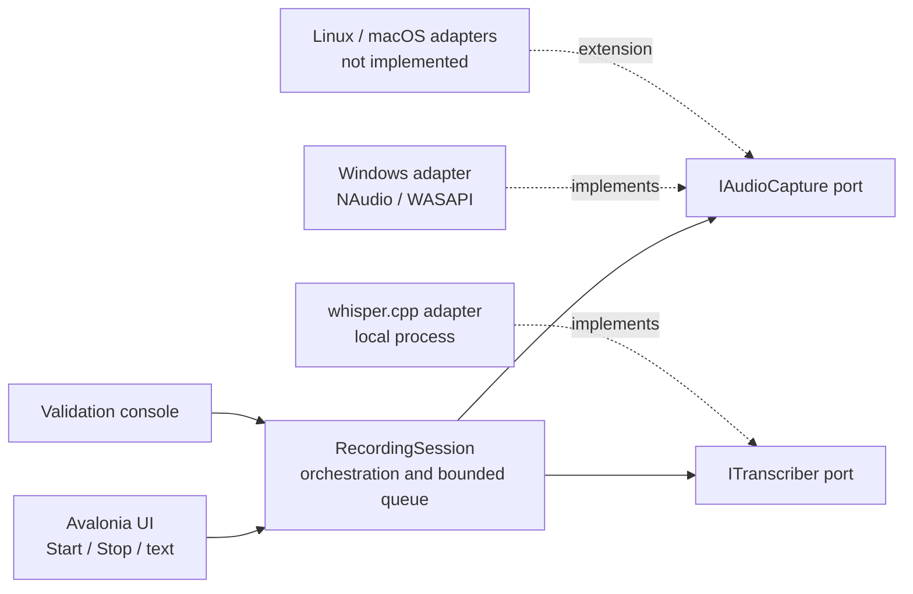
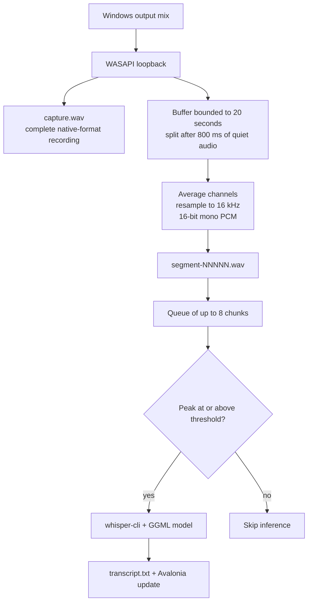
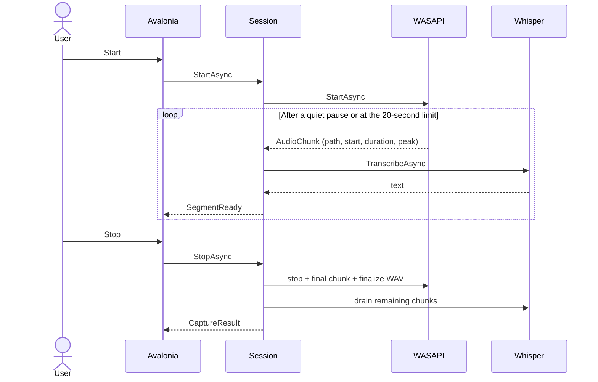

# Proof-of-concept architecture

The application core depends only on .NET. Dependencies point toward the `IAudioCapture` and `ITranscriber` ports defined in `Audio2Mcp.Core`. The desktop window and console application are the composition roots.

Contracts and domain objects are documented in their respective files. `AudioChunk.IsSilent` and `CaptureResult.IsSilent` share the near-silence threshold without claiming to detect speech. The console groups its settings in `CaptureOptions`. The window separates control construction, event wiring, and the session lifecycle.

## Data flow

`PauseBasedChunkWriter` assembles 20 ms windows of native audio independently of WASAPI packet size. It measures their RMS level across all channels and consults `PauseBoundaryDetector`, which remains independent of NAudio. After an active signal, 800 consecutive milliseconds below the 0.003 threshold end the chunk; shorter pauses remain within it. The absolute limit is 20 seconds. Without an active signal, a chunk is saved every 5 seconds. No samples are intentionally discarded, including silence before and after a signal. There is no overlap or deduplication.

Chunks are converted in the capture callback: a simple choice for a proof of concept, but one that should move to a dedicated worker for heavier workloads. The complete WAV is written before analysis and conversion. A silent playback stream on the same output keeps packets flowing during silence. Chunk files are preserved if transcription fails or falls behind. On stop, after callbacks have ended, the writer also processes the final window shorter than 20 ms and saves the remaining chunk.

## Lifecycle

The worker processes chunks in order. Stop waits for the queue to drain; each inference has a two-minute timeout. Closing the application during capture cancels Whisper by killing its process tree and preserves files already written. Inference errors are displayed without stopping capture. Device errors cause the host to initiate stop.

To support another OS, implement `IAudioCapture`: emit mono 16 kHz PCM16 WAV files, timestamps, and a peak measurement, then return a `CaptureResult`. No changes to the Whisper adapter or core are needed. To replace speech-to-text, implement `ITranscriber`.

Stereo channels do not correspond to individual speakers. Diarization would require a separate processing step; capturing the local microphone would also require a dedicated adapter and synchronization.
